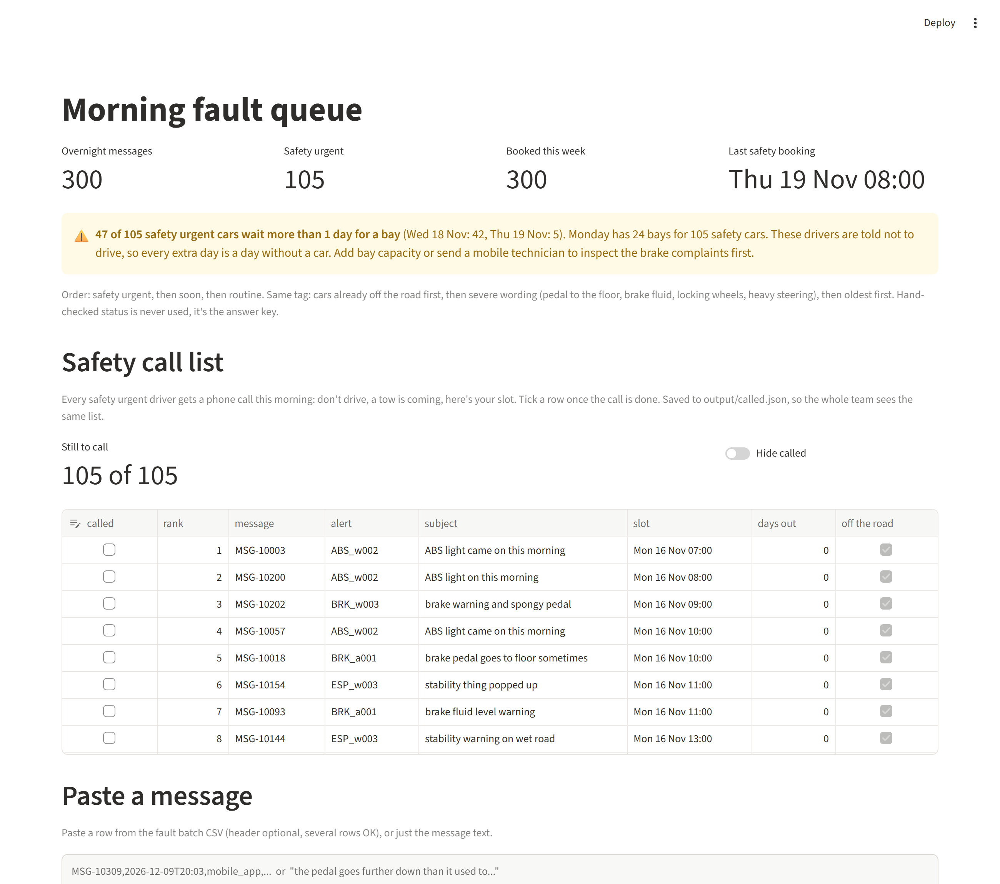
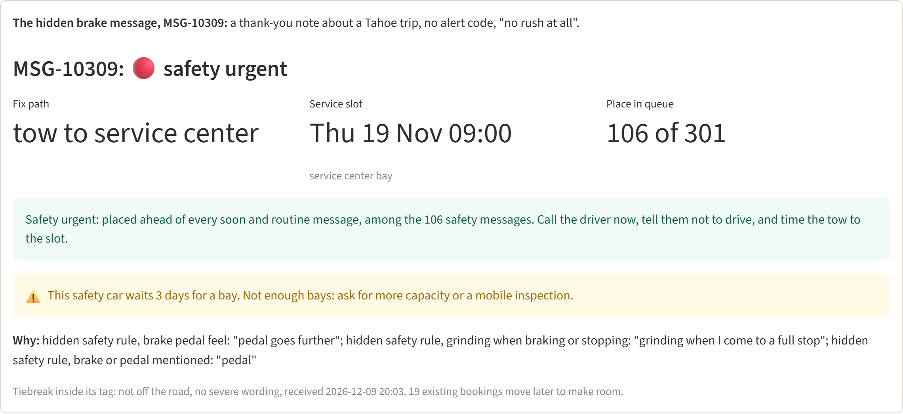

# Morning fault queue page

**The prompts I gave Claude Code are in [PROMPT.md](PROMPT.md).**

A Streamlit page that brings the first three stages together. It shows all 300 overnight messages with safety urgent on top, each with its tag, fix path and service slot. A paste box takes any new message and returns its tag, fix path, service slot and place in the queue.

```bash
pip install -r ../requirements.txt
streamlit run app.py
python -m pytest test_queue.py
```

This needs the stage 01 fault batch, the stage 03 slots CSV, and the acceptance test CSV at `data/acceptance_test_messages.csv`. All three are simulation data and are gitignored. The page makes no model calls and needs no key.

## Built for the morning

- **Not-enough-bays warning.** At the top of the page: 47 of 105 safety urgent cars wait more than a day for a bay (Wednesday 18 November: 42, Thursday 19 November: 5). Monday has 24 bays for 105 safety cars. A pasted safety message that lands that far out gets the same warning.
- **Safety call list.** Every safety urgent driver needs a call this morning. Advisors tick each one when it's done, the page counts who is still to call, and the ticks are saved to `output/called.json` so everyone sees the same list.

## Where each piece comes from

| Piece | Source |
| --- | --- |
| Tags for the 300 | stage 02 `results/tags.csv` (the model's tags plus the rules backstop) |
| Tag for a pasted message | stage 01 rules (`tag_message`), so it's instant and works offline |
| Slot rules and booking | stage 03 `Scheduler`, including the bay hold for safety |

The page books slots with code, not the model, in the order below. That keeps it deterministic: the same paste always lands in the same place.

## The tiebreak for messages with the same tag

1) **Cars already off the road first.** If the driver says the car is parked, towed or not safe to drive, it can't get them to work, and they're waiting on us.
2) **Then severe wording:** pedal to the floor, brake fluid, a sinking pedal, wheels locking, heavy steering.
3) **Then oldest first.**

**What I left out on purpose: hand-checked status.** Stage 03 used it as a tiebreak. But it's the answer key, and a new message pasted in the morning never has one. So the page can't depend on it. Because of this change, 284 of the 300 page slots fall on the same day as the stage 03 model schedule. The 16 that differ are safety messages swapping places inside the safety queue.

## Screenshots

The top of the page running locally (`streamlit run app.py`): the not-enough-bays warning and the safety call list.



MSG-10309, the Tahoe trip note, placed by the page:



## The hidden brake message, MSG-10309

It's a thank-you note about a Tahoe trip. There's no alert code, it says "no rush at all", and inside it says the pedal "goes further down than it used to" with "a faint grinding" at a full stop.

- **Tag:** safety urgent, through the stage 01 hidden safety rules (brake pedal feel, grinding when stopping).
- **Fix path:** tow to service center.
- **Place:** 106 of 301. That's ahead of all 195 soon and routine messages, behind the 105 overnight safety messages. It's newer than all of them, the car is still driving, and the wording isn't in the severe list.
- **Slot:** a service center bay, Thursday 19 November 09:00. Booking it moves 19 routine bay bookings later. No safety or soon booking moves.

**The loud messages sit lower, because the tag comes from the fault, not the tone.** MSG-10301 (wipers, "I am going to lose my mind") is soon: a mobile van on Monday 16 November at 11:00, 107 of 301. The tiebreak moves it near the top of soon because the driver can't drive it in the rain. MSG-10305 (touchscreen, "honestly furious") is routine: a remote fix that overflows to a support callback on Thursday 19 November at 13:00, 301 of 301. The car drives normally, so nothing moves it up.

All 18 acceptance messages get the same safety call as the hand check (18 of 18), including the angry wiper, door handle and touchscreen messages, which stay soon or routine.
