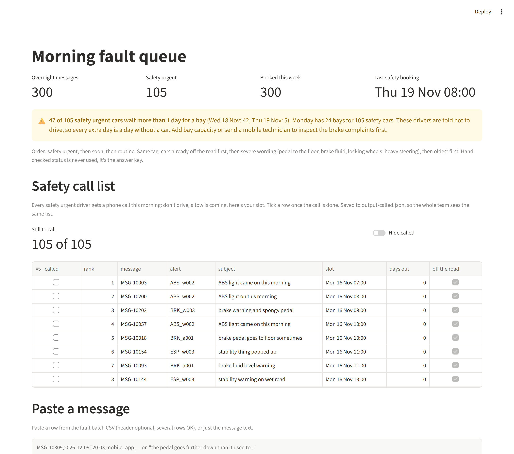

# Tesla Triage

A Tesla service center answers overnight fault messages in the order they arrive, so a brake warning can sit behind a question about wipers. This repo builds a morning fault queue that puts unsafe cars first, books every message into a service slot, and shows it all on one page.

Built in four stages for a 0.university work simulation, with Python, Pydantic, a free OpenRouter model, Streamlit and Claude Code.



## Results on 300 overnight messages

- **60 of 60** safety faults that a human checked by hand are tagged safety urgent, including 37 with no dashboard alert and 19 written in a calm "no rush" tone.
- **All 300** messages are booked into this week's slots. All 105 safety urgent cars get a service bay by Thursday 08:00, and no lower-priority message takes a bay before them.
- **18 of 18** acceptance test messages get the same safety call as the hand check. That includes MSG-10309, a thank-you note about a road trip that mentions a brake pedal going further down than it used to.

## Stages

| Stage | What it does |
| --- | --- |
| [01 Urgency rules](01-urgency-rules/) | Pydantic rules that tag each message safety urgent, soon or routine, route it to one of four fix paths, and catch safety symptoms that have no dashboard alert. |
| [02 Classify messages](02-classify-messages/) | A free OpenRouter model tags all 300 messages from the stage 01 rules. Pydantic validates every answer, and the rules run as a backstop that can only raise a tag. |
| [03 Book slots](03-book-slots/) | The model books each message through a `book_slot` tool that enforces the slot rules. Monday has 24 bays for 105 safety cars, so safety runs as a tiered queue. Includes a safety report against the hand-checked set. |
| [04 Queue page](04-queue-page/) | A Streamlit page with the whole queue, safety urgent on top, a paste box that tags and places any new message, a warning when safety cars wait more than a day for a bay, and a call list for safety drivers. [Prompts](04-queue-page/PROMPT.md). |

## Run it

```bash
pip install -r requirements.txt
python -m pytest            # 38 tests
cd 04-queue-page && streamlit run app.py
```

Stage 02 and 03 call a free OpenRouter model and need a key in `.env` (see `.env.example`). The scripts refuse any model that isn't free. The message batches are simulation data and are not in the repo: put each CSV in its stage's `data/` folder. Tests that need the data skip without it.

## Design choices

- **Recall over precision.** An extra phone call costs an advisor a few minutes. A missed brake fault can cost a crash. So tone never lowers a tag, and any brake or steering symptom is safety urgent.
- **Rules, not a trained model, for the safety call.** The 60 labels are all safety faults, which is too few to train on, and a safety call has to be explainable. Every tag quotes the words that caused it.
- **The model chooses, the code enforces.** The model tags and books, but Pydantic validates every answer, and the booking tool rejects any slot that breaks a rule.
- **No answer key in the ordering.** Hand-checked status is used to measure the system, never to rank messages, because a new message never has one.
